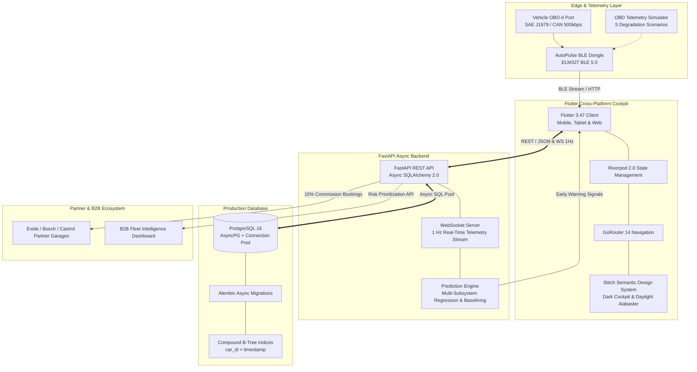

# AutoPulse — Predictive AI Automotive Health

> **"Know 9 days before your car breaks down — not 9 seconds after."**  
> *An intelligent hardware-software mobility platform for India's 40 million used car owners.*  
> *Originated at NIMS University Smart Mobility & Automotive AI Lab.*

---

## 🎯 Executive Summary & Mission

In India, **over 4.5 million used cars** are sold every year. Owners of 3-to-10-year-old vehicles (Maruti Swift, Hyundai i20, Honda City, Tata Nexon, Mahindra XUV500) live with constant roadside breakdown anxiety. Standard OBD-II code readers sold on e-commerce are dumb reactive tools: they illuminate a check-engine warning only **after** catastrophic mechanical failure has occurred, requiring ₹15,000 to ₹40,000 in engine overhauls or roadside towing.

**AutoPulse** revolutionizes used-car ownership with **Proactive Component Failure Forecasting**:
- **Hardware:** Ultra-compact **₹999 OBD-II BLE Smart Dongle**
- **SaaS Subscription:** **₹999/year (₹83/month)** AI Cloud Intelligence
- **Clear Value Proposition:** "Battery fails in ~9 days" with causal proof, saving owners an average of **₹4,500+ per incident** and connecting them instantly with verified partner garages.
- **Pilot Target:** 100 vehicles in Rajasthan / Delhi-NCR with 4 partner garage workshops.

---

## 📐 System Architecture



---

## 🎨 UI/UX Design System (Google Stitch MCP)

All screens and design tokens were designed and exported from **Google Stitch MCP** (`projects/14346551546531553546`):
- **Dark Cockpit Theme:** Deep Graphite (`#0B0F17`) background, Card Surface (`#121824`), Electric Cyan accent (`#00E5FF`), Neon Amber warning (`#F59E0B`), Flame Coral critical (`#EF4444`).
- **Daylight Light Theme:** Crisp Alabaster (`#F8FAFC`), Pure White cards (`#FFFFFF`), Slate Blue primary (`#0284C7`).
- **Typography:** Display header in **Outfit** (Bold & Geometric) + Data and body in **Inter** (High-legibility tabular figures).
- **Design Specifications:** Full design tokens and tokens hierarchy documented in [`docs/design/DESIGN.md`](file:///c:/Users/gupta/Documents/Development/AutoPulse/docs/design/DESIGN.md) and exported mockups in [`docs/design/STITCH_EXPORT.md`](file:///c:/Users/gupta/Documents/Development/AutoPulse/docs/design/STITCH_EXPORT.md).

### Implemented Screens

1. **Onboarding Screen:** 3-step value proposition cards with dot indicators.
2. **Pairing Screen:** Bluetooth radar pulse animation (`#00E5FF`), signal strength indicator, and auto-connect flow.
3. **Home Dashboard:** 160px circular gauge with dynamic Health Score (0-100), urgent hero banner ("Battery fails in ~9 days"), and 2-column subsystem chips.
4. **Live Telemetry Cockpit:** Digital RPM and Speed meters, real-time live sparklines (Battery Sag, Coolant Temp), and Freeze-Frame diagnostic button.
5. **Component Diagnostic Detail:** 30-day wear trend chart with projected redline drop, plain-English causal proof, and Net Savings Card (₹4,500 saved).
6. **Alerts Center:** Filterable alert feed sorted by Critical, Warning, and Watch with 1-tap resolution.
7. **Partner Garage Booking:** Interactive garage selector, slot booking (10:00 AM / 2:30 PM), and confirmed appointment sheet.
8. **Plans & Subscription:** ₹999 Hardware + ₹999/yr subscription vs Free Scanner feature comparison table.
9. **Pitch Comparison Matrix:** Traditional Amazon OBD-II scanner vs AutoPulse vs Dealership Scan Tool.
10. **B2B Fleet Intelligence:** Responsive risk-ranked vehicle table for dealerships and cab fleets with in-bay inspection drawer.
11. **Secret Judge Demo Panel:** Long-press AutoPulse brand mark for instant vehicle switching, fault injection, and fast-forward time lapse.

---

## 🧠 Prediction Engine: Mathematical Causal Proof

The AutoPulse failure engine ([`backend/app/engine/prediction_engine.py`](file:///c:/Users/gupta/Documents/Development/AutoPulse/backend/app/engine/prediction_engine.py)) continuously calibrates against each car's baseline rather than using static thresholds:

| Subsystem | Telemetry Indicators | Statistical Algorithm | Plain-English Causal Reason |
| :--- | :--- | :--- | :--- |
| **Battery & Starting** | Cranking voltage sag, rest voltage, charging recovery slope | Ordinary Least Squares (OLS) Linear Regression on peak cranking drops over past 21 cold starts | *"Cranking voltage is decaying at 0.08V/day. Internal plate sulfation will prevent cold start in ~9 days."* |
| **Cooling & Thermostat** | Coolant temperature, rate of temp rise $\frac{\Delta T}{\Delta t}$, ambient differential | Rolling window gradient with thermal dissipation decay modeling | *"Coolant temperature is climbing 28% faster under city idle; thermostat valve sticking."* |
| **Alternator & Charging** | Voltage under high electrical load (AC + High Beam + Defogger) | Load-step drop differential vs engine RPM charging curve | *"Regulator output dropping to 12.8V under AC load. Diode pack failing."* |
| **Spark Plugs & Ignition** | Short-term fuel trim (STFT), RPM idle stability coefficient of variation ($CV_{RPM}$) | Idle roughness variance analysis | *"Combustion misfires detected on Cylinder 3; electrode gap worn past 1.1mm."* |
| **O2 & Catalytic Emissions** | Sensor 1 vs Sensor 2 voltage amplitude ratio, cross-count frequency | Fourier cross-correlation & switching frequency decay | *"O2 sensor response time has slowed by 65%, increasing fuel consumption by 12%."* |

---

## 🔌 Hardware Transition Roadmap (Simulator → ELM327 BLE)

The software prototype is architected with a decoupled hardware abstraction layer:
- **Interface:** [`simulator/source_interface.py`](file:///c:/Users/gupta/Documents/Development/AutoPulse/simulator/source_interface.py) defines the abstract `TelemetrySource` contract.
- **Simulator Implementation:** [`simulator/obd_simulator.py`](file:///c:/Users/gupta/Documents/Development/AutoPulse/simulator/obd_simulator.py) generates high-fidelity SAE J1979 OBD-II standard PIDs at 1 Hz with noise injection and degradation models.
- **Hardware Transition:** To connect a physical ELM327 / STN1110 BLE dongle:
  1. Add `flutter_reactive_ble` or `flutter_blue_plus` package.
  2. Implement `BleObdSource` adhering to `TelemetrySource`.
  3. Query standard OBD Mode 01 PIDs:
     - `01 0C` -> Engine RPM (2 bytes)
     - `01 0D` -> Vehicle Speed (1 byte)
     - `01 05` -> Engine Coolant Temperature (1 byte: $A - 40$)
     - `01 04` -> Calculated Engine Load (1 byte: $A \times 100 / 255$)
     - `01 42` -> Control Module Voltage (2 bytes: $(256A + B) / 1000$ V)

---

## 🚀 Quickstart & Verification

### Prerequisites
- Python 3.11+
- Flutter 3.24+ / Dart 3.5+
- Docker & Docker Compose (optional for production container)

### 1. Backend Verification & Tests
```bash
# Activate virtual environment
cd backend
.venv\Scripts\activate  # Windows (or source .venv/bin/activate on Unix)

# Run prediction engine unit tests
python -m pytest backend/tests/test_prediction.py -v

# Run API integration tests
python -m pytest backend/tests/test_api.py -v

# Run code style & lint check
python -m ruff check backend
```

### 2. Run Backend Locally
```bash
python -m uvicorn backend.app.main:app --host 0.0.0.0 --port 8000 --reload
# Interactive Swagger docs: http://localhost:8000/api/docs
```

### 3. Run Dockerized Production Environment
```bash
docker compose up --build -d
# PostgreSQL 16 on port 5432 + FastAPI on port 8000
```

### 4. Run Flutter Cockpit
```bash
cd app
flutter test          # Verify widget and token tests pass
flutter run -d chrome # Or target physical Android / iOS device
```

---

## 🎬 3-Minute Demo Day Pitch Guide

A second-by-second presentation script with investor talking points is provided in:  
👉 [`docs/DEMO_SCRIPT.md`](file:///c:/Users/gupta/Documents/Development/AutoPulse/docs/DEMO_SCRIPT.md)

### Secret Judge Demo Controls
- **How to Open:** Long-press the **`AutoPulse`** logo in the top app header on Home or Settings for 2 seconds.
- **Switch Vehicles:** Toggle instantly between Swift (Battery), i20 (Cooling), City (Spark Plugs), Nexon (Alternator), and Baleno (Healthy Control).
- **Inject Faults:** Trigger instant overheat, alternator droop, or fast-forward 5/10 virtual days.

---

## ⚖️ License & Intellectual Property

Proprietary prototype developed for **AutoPulse Inc.** (NIMS University Startup Incubator). All rights reserved.